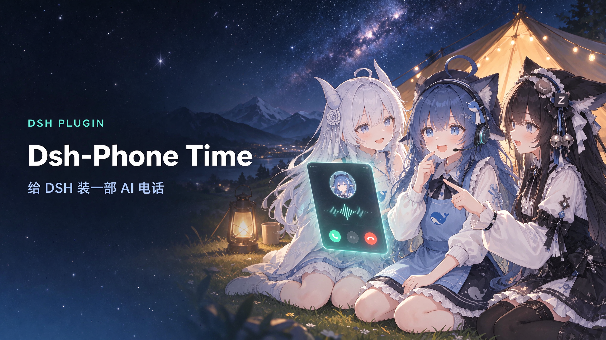

# Dsh-Phone Time

> 给 DSH 装一部 AI 电话：一条**独立于工作台**的闲聊通话通道，按你当前选中的模型接通，说完自动发、回复边说边播。

**它不替代 DSH 原生的语音输入，也不改动它。** 原生语音输入仍然是往输入框里写字；Dsh-Phone Time 是另开的通话小窗：你说一句、它答一句，通话内容不进工作台会话，也不碰你输入框里没发出去的草稿。

---

## 它能做什么

| 能力 | 说明 |
|---|---|
| 全屏通话层 | 弹出在 DSH 页面内，可拖动、可缩放、可最小化/最大化、可关闭，不跳独立窗口 |
| 按模型接通 | 直接用 DSH 当前面板选中的模型推理，不另配一套模型清单 |
| 按模型换形象 | DeepSeek / GPT / Claude / Gemini / Kimi / GLM / 千问各自一套圆形头像与声线 |
| 说完自动发 | 语音输入转成文字后自动进通话，不需要按发送 |
| 边说边播 | 回复一边流式出字，一边按句切分合成语音，不用等整段写完 |
| 公文式计费条 | 小窗底部实时显示每秒 token、本步总 token、缓存命中率、上下文余量 |
| 设置分区 | DSH 设置页里新增「语音通话」：总开关、接入 API、每个模型下拉选音色、音量/语速档位条、头像左右切换与上传 |
| 通话日志 | 每通电话自动落一份 Markdown，只记输入/输出内容与时间，放在你的工作文件夹里 |
| 克制的动效 | 打开、关闭、设置保存都有轻量过渡与提示音，不生硬 |

## 它不做什么

- **不改原生语音输入**：两者互不干扰，各自独立。
- **不写工作台会话**：电话里的对话不会进 AI 对话、不会留草稿、不会污染上下文。
- **不吞未发送草稿**：输入框里没发出去的字，不会被当作通话指令。
- **不自己存密钥**：密钥沿用 DSH 的 `.credentials.yaml` 与用户级环境变量。
- **第一句一定是你先说**：接通后它不会抢话。

---

## 安装

完整步骤见 [docs/INSTALL.md](docs/INSTALL.md)。三步概要：

1. 把整个文件夹放到 `%USERPROFILE%\.dsh\local-plugins\dsh-ai-phone`（并同步一份到 `%USERPROFILE%\.dsh\profiles\desktop\node_modules\dsh-ai-phone`）。
2. 在 `%USERPROFILE%\.dsh\profiles\desktop\package.json` 的 `dependencies` 里加 `"dsh-ai-phone": "file:..."`。
3. 重启 DSH，浏览器打开 `http://127.0.0.1:18770/phone/health`，看到 `{"ok":true,...}` 即安装成功。

## 使用

完整说明见 [docs/USER-GUIDE.md](docs/USER-GUIDE.md)。最小流程：

1. DSH 设置 → **语音通话** → 打开总开关、填好接入 API（TTS 密钥）；
2. 点右下角电话按钮，弹出通话窗；
3. 点麦克风说第一句，说完自动发送；
4. 它开始出字并念出来，麦克风随时可以打断、挂断键结束通话；
5. 想换音色/头像，回设置页切两个滑轨即可。

---

## 它怎么工作

```
麦克风 → DSH 原生语音输入（转文字） → 通话窗读取结果
        → POST /phone/chat（本机 18770）
        → 读 DSH 的 cordis.patch.yml 找出 provider / 模型 / baseURL
        → 从 .credentials.yaml 取 key → 直连 /chat/completions（SSE 流式）
        → 边收字边按句切分 → POST /phone/speak → 火山豆包 TTS 合成 wav
        → 小窗播放，同时把 delta 写进小窗和日志
```

整条链路不碰 DSH 的任务调度与会话存储，所以电话打得再久，工作台还是干净的。

技术细节、路由表、NDJSON 行协议见 [docs/DEV-NOTES.md](docs/DEV-NOTES.md)。

---

## 配置

首次启动自动生成 `%USERPROFILE%\.dsh\dsh-ai-phone.json`。常用字段：

| 字段 | 类型 | 默认 | 说明 |
|---|---|---|---|
| `enabled` | boolean | `true` | 电话功能总开关 |
| `shortcut` | string | `Alt+Shift+P` | 唤起快捷键 |
| `apiKey` | string | `""` | 自定义 TTS 密钥；留空则用 `VOLCENGINE_TTS_API_KEY` |
| `endpoint` | string | 火山官方端点 | 自定义 TTS 端点（走代理时改这里） |
| `baseVoice` | string | 一个默认女声 | 匹配不到模型时用的兜底声线 |
| `voices` | object | 7 个模型各一条 | `模型关键字 → 音色 id` |
| `avatars` | object | 空 | `模型关键字 → 本地图片路径` |
| `speechRate` | number | `0` | 语速，范围 -50 ~ 100 |
| `loudness` | number | `0` | 音量，范围 -50 ~ 100 |
| `logEnabled` | boolean | `true` | 是否写通话日志 |
| `logDir` | string | `~/Documents/DSH-AI通话日志` | 日志目录，可改到你的工作文件夹 |
| `isolateSession` | boolean | `true` | 通话与会话隔离 |
| `avatarPos` | object | `{}` | 每个模型头像的裁切偏移 |

保存时先写临时文件再改名，并自动留一份 `.bak-auto`；写到一半断电也不会毁掉整份配置。

## 目录结构

```
Dsh-Phone-Time/
├─ lib/
│  ├─ index.js      宿主侧：TTS、配置、模型解析、HTTP 接口
│  ├─ client.js     前端：通话窗、设置页「语音通话」分区
│  └─ panel.js      历史独立面板页（前端已不再使用，仅保留 /phone/panel 路由）
├─ cordis.patch.yml 插件加载声明
├─ package.json
├─ docs/
│  ├─ INSTALL.md    部署操作手册
│  ├─ USER-GUIDE.md 用户手册
│  └─ DEV-NOTES.md  源码说明
└─ assets/
   └─ poster.png    宣传图
```

## 已知限制

- **只适用于 Windows 桌面版 DSH**：路径、`%TEMP%`、`%USERPROFILE%` 都按 Windows 写。
- **不能与同名插件并存**：端口（18770 起）、配置文件、头像目录、样式前缀都与 `dsh-ai-phone` 共用，装第二份必须先把这些隔离开。
- **头像需自备**：仓库不附带任何角色图，首次安装头像为空，通话窗显示占位形状；在设置页上传即可。
- **依赖 DSH 的 provider 配置**：如果你在 DSH 里没有配好某个 provider 或没填 key，对应模型在电话里就接不通。
- **个别第三方中转的连接握手会超时**：Node 自带的 undici 默认 10 秒连接超时，慢中转会表现成一句 `fetch failed`。插件已对连接级失败自动重试一次，并在失败时给出明确文案；DeepSeek 系列会优先直连官方接口。

## 许可

[MIT](LICENSE)。
